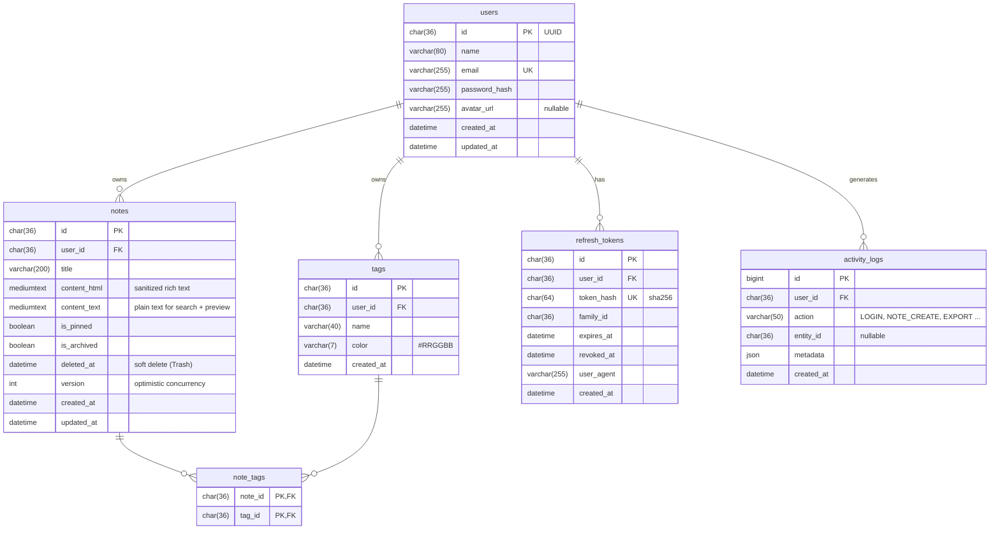

# 03 — Database Design (MySQL 8)

## 1. ER Diagram

## 2. Design Decisions

| Decision | Why |
|---|---|
| UUID primary keys | Non-guessable IDs in URLs (no `/notes/1`, `/notes/2` enumeration). |
| `content_html` **and** `content_text` | HTML for rendering; plain text for FULLTEXT search, previews, Markdown export, word count. Both written by the service on save. |
| Soft delete via `deleted_at` | Enables Trash + Undo. A scheduled cleanup purges items older than 30 days. |
| `version` column | Optimistic locking: update with `WHERE id=? AND version=?`; mismatch → 409 so two tabs never silently overwrite each other. |
| Tags are per-user, unique `(user_id, name)` | Users' tags are isolated. |
| Refresh tokens stored as SHA-256 hash with `family_id` | A DB leak doesn't leak usable tokens; family enables reuse detection. |
| `activity_logs` table | "User activities" from the brief — also powers profile stats. Pino still logs everything; this table is the queryable audit trail. |
| `ON DELETE CASCADE` from users | Deleting an account removes all owned data. |

## 3. Indexes

| Table | Index | Serves |
|---|---|---|
| users | `UNIQUE(email)` | login lookup |
| notes | `(user_id, deleted_at, is_archived, is_pinned, updated_at)` | dashboard list + filters + sort |
| notes | `FULLTEXT(title, content_text)` | search |
| tags | `UNIQUE(user_id, name)` | tag lookup / no duplicates |
| note_tags | PK `(note_id, tag_id)` + `INDEX(tag_id)` | filter by tag |
| refresh_tokens | `UNIQUE(token_hash)`, `INDEX(user_id)` | refresh, revoke-all |
| activity_logs | `(user_id, created_at)` | recent activity |

## 4. Migrations & Seed

- `npx prisma migrate dev` creates versioned SQL migrations committed under `server/prisma/migrations/`.
- FULLTEXT index added via a custom SQL step inside a migration if Prisma's generator doesn't emit it.
- `npm run db:seed` → demo user (`demo@noteflow.dev`, password in `.env.example`) with ~15 realistic notes and 5 tags — so the reviewer sees a populated app instantly.
- Separate test database `noteflow_test`, reset before integration test runs.
