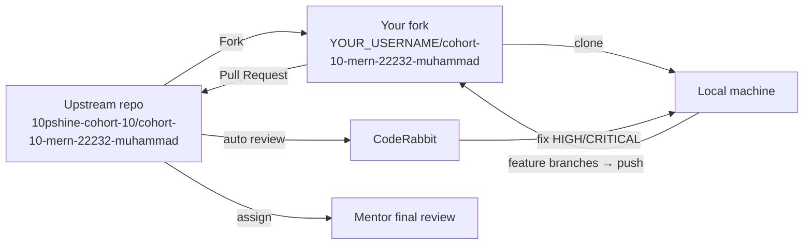

# 07 — Git Workflow & Submission Process

## 1. Submission Flow (from the Shine email)



1. Fork the upstream repo to your GitHub account.
2. `git clone https://github.com/YOUR_USERNAME/cohort-10-mern-22232-muhammad.git`
3. Add upstream remote: `git remote add upstream https://github.com/10pshine-cohort-10/cohort-10-mern-22232-muhammad.git`
4. Work on branches (below), push to the fork.
5. Open PR(s) **from fork → upstream `main`**.
6. CodeRabbit reviews within minutes → fix **all HIGH & CRITICAL**, ideally MEDIUM too; reply to every comment (resolved / explained).
7. When clean, assign the PR to the mentor.

## 2. Branching Strategy (Git Flow–lite)

| Branch | Purpose |
|---|---|
| `main` | Stable, release-ready. Only receives merges from `develop` (releases) or hotfixes. |
| `develop` | Integration branch; every feature merges here first. |
| `feature/<scope>-<short-desc>` | One feature each, e.g. `feature/auth-jwt`, `feature/notes-crud`, `feature/editor-tiptap`. |
| `fix/<desc>` | Bug fixes. |
| `chore/<desc>` · `docs/<desc>` · `test/<desc>` | Tooling, docs, tests. |
| `release/v1.0.0` | Final polish before submission (optional). |

Rules: no direct commits to `main`/`develop`; every feature goes through a PR in the fork (self-review checklist) with `--no-ff` merges so history shows features; tag releases `v0.1.0` … `v1.0.0`.

### PRs to upstream (confirmed by mentor)
The mentor's rule: **each feature is completed and submitted as a separate PR before moving to the next one.** Push to the fork continuously while working, and open one PR per feature:

| PR | Branch | Contents |
|---|---|---|
| 1 | `feature/project-setup` | Planning docs, monorepo, tooling, Express + Pino + error handler, Vite app, CI |
| 2 | `feature/auth` | Sign up / log in / log out, JWT, protected routes, tests |
| 3 | `feature/notes-crud` | Notes API + dashboard + tests |
| 4 | `feature/rich-text-editor` | Tiptap editor, autosave, save/cancel |
| 5 | `feature/tags-pin-archive-trash` | Organization features |
| 6 | `feature/search-filter` | FULLTEXT search, filters, sort |
| 7 | `feature/export-import` | JSON / Markdown export, import |
| 8 | `feature/realtime-sync` | Socket.IO |
| 9 | `feature/user-profile` | Profile screen, change password, activity |
| 10 | `chore/sonarqube-polish` | Sonar fixes, a11y, Lighthouse, README, screenshots |

Per-feature loop: sync `main` from upstream → branch → commit & push often → open PR → fix CodeRabbit HIGH/CRITICAL → assign mentor → next feature.
If upstream PRs are **not merged** before the next feature starts, branch the next feature from the previous feature branch (stacked PRs) and rebase onto `main` once the earlier PR is merged.

## 3. Commit Convention (Conventional Commits, enforced by commitlint)

```
feat(notes): add soft delete and restore endpoints
fix(auth): rotate refresh token on every refresh
test(notes): cover version conflict in notes service
refactor(editor): extract toolbar into its own component
docs(readme): add setup instructions and screenshots
chore(ci): add github actions workflow
```
Small, focused commits (one logical change each). Aim for a readable history of 100+ meaningful commits rather than a few huge dumps.

## 4. PR Template (`.github/pull_request_template.md`)
```
## What
## Why
## How to test
## Screenshots
## Checklist
- [ ] Lint, typecheck and tests pass
- [ ] Coverage not reduced
- [ ] No secrets / .env committed
- [ ] Docs updated
```

## 5. CI (GitHub Actions — `.github/workflows/ci.yml`)
On every push / PR: install → lint → typecheck → backend tests (MySQL service container) → frontend tests → build. Status badge in README.
